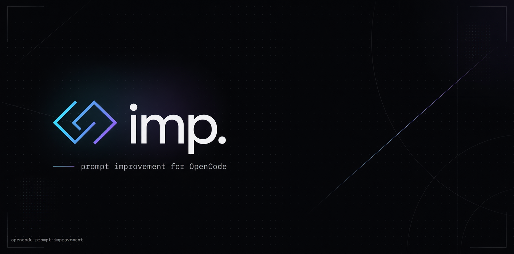

<p align="center">
  
</p>

<div align="center">

[](https://github.com/ASTRO-CLOU/opencode-prompt-improvement/actions/workflows/ci.yml)
[](LICENSE)
[](https://opencode.ai)
[](package.json)

[English](README.md) | [Русский](README.ru.md) | [العربية](README.ar.md) | [Deutsch](README.de.md) | [Español](README.es.md) | [Français](README.fr.md) | [हिन्दी](README.hi.md) | [Italiano](README.it.md) | [日本語](README.ja.md) | [한국어](README.ko.md) | [Português](README.pt.md) | [中文](README.zh.md)

</div>

Um plugin do OpenCode que melhora o seu prompt antes de ele chegar ao modelo. Você escreve uma mensagem curta; a conversa recebe uma versão mais limpa e estruturada. O modelo e a interface mostram exatamente o texto reescrito.

**Compatibilidade:** OpenCode V2, testado em 2.3.2+ com a API de plugins 2.4.2. Node.js 22.18+ apenas para compilar do código-fonte. Sem telemetria; o modo determinístico não exige conta.

## Requisitos

- OpenCode V2 (2.3.2 ou superior).
- Node.js 22.18+ apenas se você compilar do código-fonte.
- Opcional: um modelo para a etapa LLM (llama.cpp/Ollama local ou qualquer provedor do OpenCode).

## Instalação

Instalar pelo GitHub:

```sh
opencode plugin add github:ASTRO-CLOU/opencode-prompt-improvement
```

```jsonc title="opencode.jsonc"
{
  "$schema": "https://opencode.ai/config.json",
  "plugins": ["github:ASTRO-CLOU/opencode-prompt-improvement"]
}
```

Execute `/reload` no OpenCode após instalar. Para fixar uma versão: `github:ASTRO-CLOU/opencode-prompt-improvement#v0.0.1`.

## Comandos

Todos os comandos respondem por notificações e nunca iniciam um agente.

| Comando | Descrição |
| --- | --- |
| `/imp-status` | Mostrar estado, modo, modelo e cota |
| `/imp-on` / `/imp-off` | Ativar ou desativar a melhoria |
| `/imp-models [filter]` | Listar modelos disponíveis para este plugin |
| `/imp-model [provider/id#variant]` | Escolher modelo e variante; `status` mostra o atual |
| `/imp-model off` | Manter a limpeza, desativar chamadas ao modelo |
| `/imp-force <prompt>` | Melhorar um prompt uma vez, mesmo com a melhoria desativada |
| `/imp-config [chave valor]` | Mostrar ou alterar configurações em tempo de execução |

`/imp-config` mostra os valores atuais, altera uma configuração ou limpa todas as substituições com `reset`. Use `clear` como valor para remover uma única substituição. Chaves: `mode`, `model`, `maxGrowth`, `skipCommands`, `skipDetailed`, `detailedThreshold`, `llmTimeoutMs`.

`/imp-force` reenvia seu texto pelo hook com uma marca interna. Ele ignora o interruptor e as regras de omissão, mas mantém todas as verificações de segurança. A marca nunca chega ao modelo nem ao histórico.

## Configuração

Os comandos salvam configurações por sessão. As opções também podem ser definidas globalmente:

```jsonc title="opencode.jsonc"
{
  "$schema": "https://opencode.ai/config.json",
  "plugins": ["github:ASTRO-CLOU/opencode-prompt-improvement"],
  "plugin": {
    "opencode-prompt-improvement": {
      "mode": "llm",
      "model": { "providerID": "llamacpp", "id": "qwen3-8b", "variant": "none" },
      "maxGrowth": 0.4,
      "skipCommands": true,
      "skipDetailed": true,
      "detailedThreshold": 2000,
      "llmTimeoutMs": 20000
    }
  }
}
```

| Opção | Padrão | Significado |
| --- | --- | --- |
| `mode` | `deterministic` | `deterministic` (sem chamadas ao modelo) ou `llm` (reescrita com fallback) |
| `model` | none | Obrigatório para `llm`: `{ providerID, id, variant? }` |
| `maxGrowth` | `0.4` | Crescimento máximo do tamanho, 0–1 |
| `skipCommands` | `true` | Ignorar prompts que começam com `/` |
| `skipDetailed` | `true` | Ignorar prompts longos ou já estruturados |
| `detailedThreshold` | `2000` | Número de caracteres considerado longo |
| `llmTimeoutMs` | `20000` | Tempo limite da chamada ao modelo, em milissegundos |

## Como funciona

- Um hook `prompt` atua na admissão e atualiza `text` e `metadata.displayText`; a conversa mostra exatamente o que o modelo recebe.

- A limpeza determinística remove caracteres invisíveis, espaços e linhas em branco repetidos, preservando código, menções e âncoras.

- No modo `llm`, primeiro é chamado `ctx.experimental.generate.text`: apenas seu texto e a instrução, sem o prompt de sistema do OpenCode. Uma sessão temporária é o fallback.

- A instrução interna pede três linhas com títulos localizados: `Кто: / Задача: / Важно:` para entradas em russo, `Who: / Task: / Important:` para outros idiomas e `/no_think` para Qwen3. Prompts com `@menções` ignoram a etapa LLM.

## Segurança

- Todos os caminhos, URLs, números, identificadores, trechos entre crases e `@menções` devem sobreviver. Novos são rejeitados.

- A saída pode ter no máximo 40% a mais que a entrada.

- Blocos de código nunca são tocados; alterar código inline rejeita a edição.

- Uma reescrita que perde mais de 10% do texto original é rejeitada.

- Por padrão, prompts vazios, `/comandos`, prefixo `*` e textos com mais de 2000 caracteres são ignorados. Os deslocamentos das menções são recalculados ou o prompt fica intacto.

## Proteção da cota

Reescritas bem-sucedidas ficam em cache: o mesmo prompt e modelo reaproveitam o resultado sem nova chamada.

Um erro de limite ou taxa inicia uma pausa de 6 horas; durante a pausa, apenas a limpeza determinística atua.

`/imp-model off` mantém a limpeza sem chamadas ao modelo; `/imp-off` desativa o plugin por completo.

## Modelos locais

Um modelo local não consome a cota da conta. llama.cpp dá controle exato de contexto e VRAM; Ollama é a opção de um comando.

### llama.cpp (contexto 16K)

Instale os binários, baixe `Qwen3-8B-Q4_K_M` (~5 GB) e inicie o servidor compatível com OpenAI. Se o Hugging Face cair a conexão, o ModelScope é usado.

```powershell
winget install --id ggml.llamacpp --exact
```

```powershell
New-Item -ItemType Directory -Force "$env:LOCALAPPDATA\opencode\llama\models" | Out-Null
curl.exe -L -o "$env:LOCALAPPDATA\opencode\llama\models\Qwen3-8B-Q4_K_M.gguf" `
  "https://www.modelscope.cn/api/v1/models/unsloth/Qwen3-8B-GGUF/repo?Revision=master&FilePath=Qwen3-8B-Q4_K_M.gguf"
```

```powershell
& "$env:LOCALAPPDATA\opencode\llama\bin\llama-server.exe" `
  -m "$env:LOCALAPPDATA\opencode\llama\models\Qwen3-8B-Q4_K_M.gguf" `
  -c 16384 -ctk q8_0 -ctv q8_0 -fa on -ngl 99 `
  --port 8080 -a qwen3-8b
```

Registre o servidor na configuração global do OpenCode, mantendo sua entrada `plugins`:

```jsonc title="opencode.jsonc"
{
  "$schema": "https://opencode.ai/config.json",
  "model": "llamacpp/qwen3-8b",
  "providers": {
    "llamacpp": {
      "name": "llama.cpp",
      "package": "@opencode/ai/providers/openai-compatible",
      "settings": { "baseURL": "http://127.0.0.1:8080/v1" },
      "models": {
        "qwen3-8b": {
          "name": "Qwen3 8B (llama.cpp)",
          "modelID": "qwen3-8b",
          "limit": { "context": 16384, "output": 4096 }
        }
      }
    }
  }
}
```

Execute `/reload` e depois escolha o modelo neste plugin:

```text
/imp-model llamacpp/qwen3-8b
```

### Ollama

Instale a [Ollama](https://ollama.com), inicie-a e baixe um modelo. O OpenCode a descobre automaticamente em `http://127.0.0.1:11434`.

```sh
ollama serve
ollama pull qwen3:8b
```

```text
/imp-model ollama/qwen3:8b
```

| Opção | Melhor para | Compromisso |
| --- | --- | --- |
| llama.cpp | contexto 16K e ajuste de VRAM explícitos | um comando de servidor mais uma entrada de configuração |
| Ollama | configuração mais rápida e descoberta automática | menos opções de baixo nível |

Em uma placa de 8 GB, um contexto de 8K–16K é suficiente. 128K exige muito mais VRAM.

## Solução de problemas

| Sintoma | Correção |
| --- | --- |
| Plugin ausente em `opencode plugin list` | Reinstale e verifique o acesso ao GitHub; para um fork privado, use uma URL autenticada. |
| Comandos funcionam, sem notificações | Coloque o plugin na configuração global e execute `/reload`. |
| O modo `llm` não muda nada | Verifique `/imp-model status`; escolha outro modelo com `/imp-models` e `/imp-model provedor/id#variante`. Remova `@menções`. |
| Modelo local ausente em `/imp-models` | Mantenha `llama-server.exe` na porta 8080 ou `ollama serve` rodando, depois `/reload`. |
| A conversa mostra o texto original | Execute `/reload` para que a parte do servidor use o código atual. |

Logs: `~/.local/share/opencode/log/opencode.log`. Para uma reprodução, use `OPENCODE_LOG_LEVEL=DEBUG`.

## Desenvolvimento

```sh
git clone https://github.com/ASTRO-CLOU/opencode-prompt-improvement.git
cd opencode-prompt-improvement
npm install
npm run check
```

`npm run check` executa testes, verificação de tipos e build da GUI. Os testes exigem Node 22.18+ e executam TypeScript diretamente com `node --test`.

## Licença

MIT. Veja [LICENSE](LICENSE).
